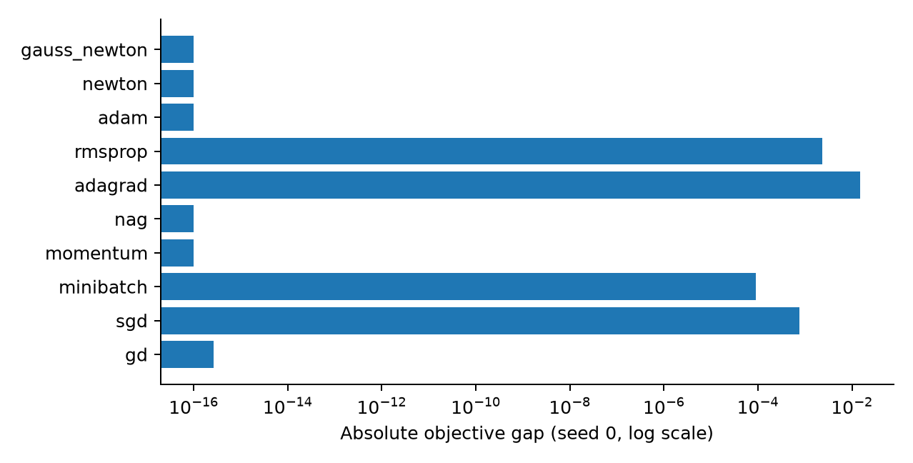
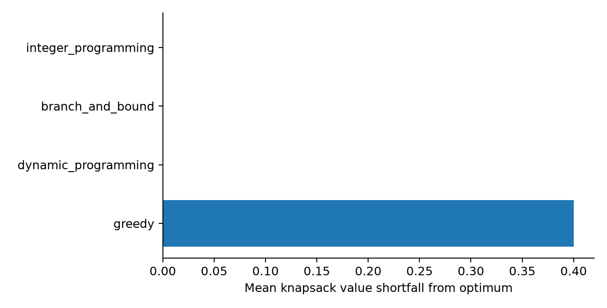
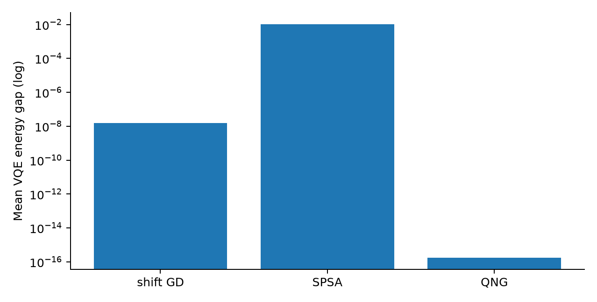
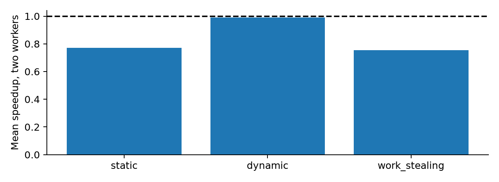
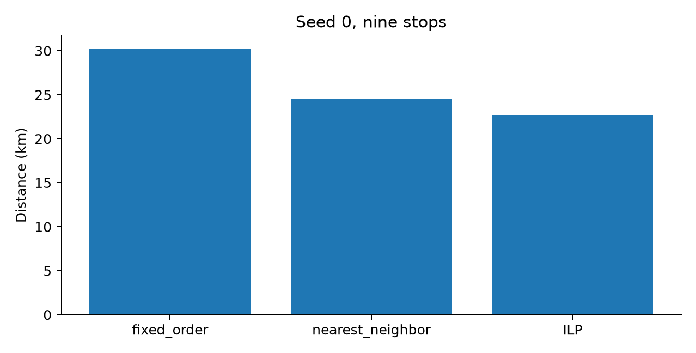
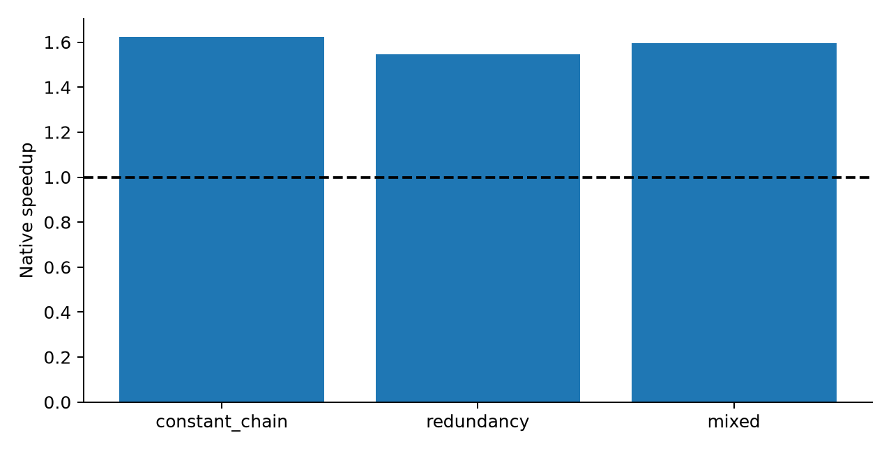
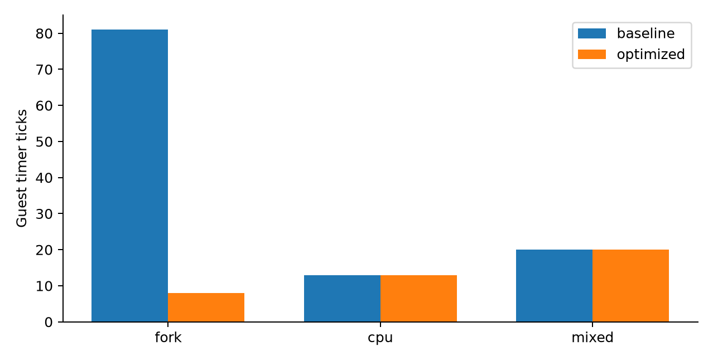
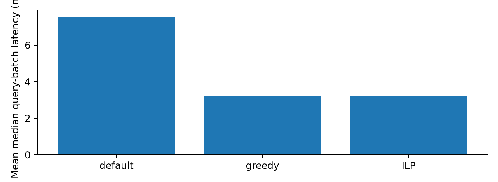
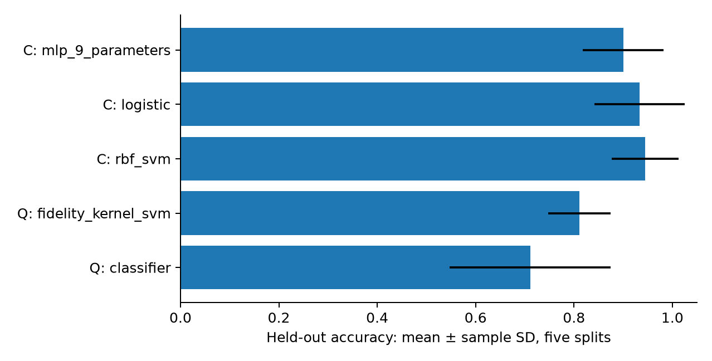
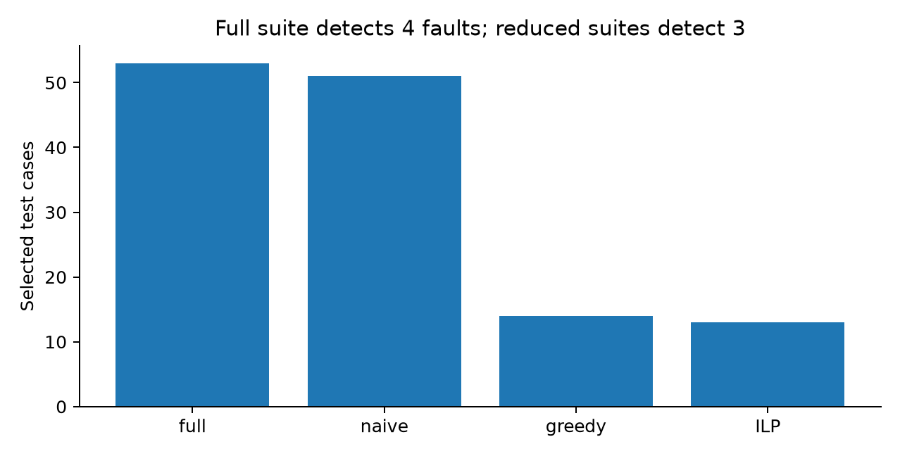

# Assignment 8 - Optimize Anything

Technical report. All figures and tables are derived from saved full-run results; generated 2026-10-15.

## Track A - Continuous optimization

[Source code](../optlab/track_a.py) | [Full results](../results/A.json)

Minimize regression/ML loss over continuous parameters; compare convex, strongly convex and nonconvex landscapes.

Five seeded datasets; identical initial parameters. GD, SGD, mini-batch, Momentum, NAG, AdaGrad, RMSProp, Adam, Newton and Gauss-Newton are implemented. A nonlinear exponential residual distinguishes the two curvature methods. Manual neural-network backpropagation is checked independently of GD/Adam. Fisher, diagonal/low-rank approximations and Hessian-vector products are measured. Validation selects step size; noise and L2 regularization are varied.

Least-squares reference and finite-difference derivative checks establish correctness. Equal update counts are not equal sample-gradient budgets; counts are retained. Saddle initialization can stall and aggressive rates diverge. These small tasks do not establish a universal best optimizer.

| Method (strongly_convex) | Mean objective gap | Mean seconds |
| --- | --- | --- |
| gd | 5.395e-17 | 0.0041123 |
| sgd | 0.0013433 | 0.0031295 |
| minibatch | 0.0001374 | 0.0031612 |
| momentum | -2.3419e-18 | 0.0044339 |
| nag | -9.541e-19 | 0.0048065 |
| adagrad | 0.047321 | 0.0048283 |
| rmsprop | 0.0030051 | 0.0051639 |
| adam | -1.648e-18 | 0.0060959 |
| newton | -1.0408e-18 | 0.0084204 |
| gauss_newton | -1.0408e-18 | 0.0083359 |

## Track B - Discrete optimization

[Source code](../optlab/track_b.py) | [Full results](../results/B.json)

Maximize knapsack value under integer capacity; demonstrate exact and heuristic discrete optimization and QUBO/Ising conversion.

Five 24-item instances compare ratio greedy, dynamic programming, branch-and-bound and ILP. Each timing has a warm-up and repeated samples. Exact methods are checked against exhaustive tiny-instance enumeration. Four-cycle Max-Cut is represented as QUBO and Ising energies; all 16 assignments agree. Cardinality-two selection demonstrates a penalty exceeding possible objective gains.

Greedy is not exact. DP is pseudo-polynomial; storing reconstruction tuples adds path-copy costs. Branch-and-bound uses exact rational ordering and integer bounds after review exposed float precision errors. ILP uses floating-point coefficients on these small bounded integers.

| Method | Mean optimum gap | Mean median seconds |
| --- | --- | --- |
| greedy | 0.4 | 2.0142e-05 |
| dynamic_programming | 0 | 8.76e-05 |
| branch_and_bound | 0 | 5.2958e-05 |
| integer_programming | 0 | 0.0031667 |

## Track C - Quantum optimization

[Source code](../optlab/track_c.py) | [Full results](../results/C.json)

Optimize parameterized quantum circuits with classical feedback; compare objective quality, circuit counts and measurement cost.

Five seeds: p=2 QAOA solves the same four-cycle as B, VQE minimizes Z0+Z1+0.5 X0X1, and a PQC regresses sin(x). Parameter-shift gradient descent, SPSA and regularized quantum natural gradient share initial conditions. A density-matrix depolarizing hardware-noise model and finite-shot sampling study measurement error. Random circuits at 2/4/6/8 qubits probe gradient variance.

QAOA is bounded by exact enumeration and VQE by diagonalization. QNG state-derivative overhead is counted separately. Statevectors/density matrices run on a classical CPU, not a QPU. Small size/depth sweeps do not prove asymptotic barren plateaus; clean-angle evaluation under noise is not noisy retraining.

| Experiment | Measured value | Meaning |
| --- | --- | --- |
| QAOA | 4 | exact cut 4 |
| VQE | 1.3323e-15 | max absolute energy error |
| parameter_shift_gradient | 1.5501e-08 | mean energy gap |
| SPSA | 0.010345 | mean energy gap |
| quantum_natural_gradient | 1.7764e-16 | mean energy gap |

## Track D - Submodular, parallel and distributed

[Source code](../optlab/track_d.py) | [Full results](../results/D.json)

Maximize submodular coverage; reduce parallel makespan; study communication and conflicting learning objectives.

Coverage greedy is checked against exhaustive optima and diminishing-return conditions, including a 5/6 counterexample. Real spawned processes execute static, dynamic and work-stealing scheduling, locality experiments and data/model/pipeline decompositions. FedAvg varies local steps and rounds against centralized gradient work. MGDA and GradNorm balance a two-task shared model against equal weights.

Parallel outputs match serial references. Timings include spawn, IPC, synchronization and shutdown; small tasks often slow down. FedAvg clients are sequential simulations, not a measured network. Amdahl and Gustafson predictions use stated assumed serial fractions; actual speedup and efficiency are separate measurements.

| Scheduler | Mean speedup | Mean efficiency |
| --- | --- | --- |
| static | 0.77181 | 0.3859 |
| dynamic | 0.99119 | 0.49559 |
| work_stealing | 0.75508 | 0.37754 |

## Track E - Campus shuttle routing

[Source code](../optlab/track_e.py) | [Full results](../results/E.json)

Reduce the travel distance of a simulated campus shuttle while serving every stop within capacity six.

Synthetic baseline: index-order visitation, returning to the depot when necessary. Five seeds create 5- and 9-stop datasets in a six-kilometre square with demand 1-3. Compare feasible nearest-neighbor routes with binary-arc ILP using load-based MTZ constraints. Minimize sum(d_ij*x_ij); one arrival/departure per stop, balanced depot flow, q_i <= u_i <= Q and u_i-u_j+Q*x_ij <= Q-q_j.

Every route is checked for unique stop coverage and capacity. Four-stop solutions are checked against independent permutation/partition enumeration. Solver statuses, bounds and gaps are retained with a 20-second limit. This is simulated evidence, not an actual campus survey; roads, time windows and fleet limits are excluded.

| Stops | Method | Mean distance km |
| --- | --- | --- |
| 5 | fixed_order | 19.924 |
| 5 | nearest_neighbor | 16.761 |
| 5 | ILP | 15.752 |
| 9 | fixed_order | 31.281 |
| 9 | nearest_neighbor | 25.39 |
| 9 | ILP | 22.653 |

## Track F - Compiler optimization

[Source code](../optlab/track_f.py) | [Full results](../results/F.json)

Reduce generated code cost without changing unsigned 64-bit program behavior; optimize compiler pass ordering.

A toy-language lexer/parser produces temporary-based IR, interpreted and compiled to C. Four passes: constant folding, propagation, dead-code elimination and common-subexpression elimination. Greedy triple-pass lookahead minimizes weighted IR cost, subject to output equivalence. Native Clang -O0 executables run 100 million inputs, with five CPU-time samples per variant.

All 24 pass permutations are checked on representative programs; native checksums match. Frontend, optimization search, backend and end-to-end compilation costs are recorded after review found omitted overhead. Static function instruction counts are not retired hardware counters; executable padding can hide size reductions.

| Program | Native speedup | Instructions before / after |
| --- | --- | --- |
| constant_chain | 1.6228 | 19 / 9 |
| redundancy | 1.5465 | 25 / 12 |
| mixed | 1.5969 | 35 / 15 |

## Track G - xv6 operating-system optimization

[Source code](../optlab/track_g.py) | [Full results](../results/G.json)

Optimize xv6 memory sharing and scheduling while preserving kernel correctness.

Pinned MIT xv6-riscv runs in QEMU. Baseline round-robin/eager fork is compared with equal-ticket lottery scheduling and copy-on-write fork. Page-reference counts, store faults and kernel copyout handle COW; read-only pages remain protected. Three repetitions each of fork-heavy, CPU and mixed CPU/sleep workloads are measured in guest timer ticks.

Fresh-disk full upstream usertests pass for baseline one hart, optimized one hart and optimized three harts; raw logs are retained. Two simultaneous kernel changes prevent clean causal attribution. Fork gains plausibly come from avoided copying. No scheduler fairness advantage is claimed. QEMU timing is not physical RISC-V performance.

| Workload | Baseline ticks | Optimized ticks |
| --- | --- | --- |
| fork | 81 | 8 |
| cpu | 13 | 13 |
| mixed | 20 | 20 |

## Track H - Database index selection

[Source code](../optlab/track_h.py) | [Full results](../results/H.json)

Choose database indexes to reduce a real SQLite query workload under a storage budget.

Five synthetic 50,000-row sales databases and five fixed SQL queries compare default no-secondary-index planning with greedy and ILP index selection. Candidate sizes are measured occupied pages. The binary objective sums isolated latency gains subject to 40% of total candidate storage. Chosen combinations are then actually benchmarked; EXPLAIN QUERY PLAN and exact result hashes are retained.

Integer currency avoids floating-point aggregation-order changes. Median warm-cache latency, raw samples, sequential throughput and storage are measured. Additive gain estimates ignore index interactions, so ILP optimality applies to the selection model, not necessarily measured runtime. Normalized objective units avoid solver-tolerance errors.

| Index policy | Mean latency ms | Mean storage bytes |
| --- | --- | --- |
| default_no_secondary_indexes | 7.5123 | 917504 |
| greedy | 3.2145 | 1994752 |
| ILP | 3.2164 | 1994752 |

## Track I - Quantum algorithms and QML

[Source code](../optlab/track_i.py) | [Full results](../results/I.json)

Measure quantum algorithm behavior and QML tradeoffs relative to classical methods.

Direct circuits demonstrate Deutsch-Jozsa, Bernstein-Vazirani, Grover, QFT, QPE and Shor order finding for 15. Suzuki-Trotter Monte Carlo models annealing and is compared with classical annealing. A nine-parameter variational classifier and fidelity-kernel SVM share train/test rows with classical models on 72 two-moons samples. Scalers fit training data only.

Grover includes actual linear-search comparisons, logical gate/query counts and separately labeled simulator timings. QML reports accuracy, training time, parameters and circuit evaluations; cached feature-state work differs from hardware overlap circuits. Classical models outperform these quantum classifiers on average. Dense Shor multiplication and simulated annealing are small demonstrations, not scalable hardware implementations.

| Model | Mean test accuracy | Sample SD |
| --- | --- | --- |
| variational_quantum_classifier | 0.71111 | 0.16387 |
| quantum_fidelity_kernel_svm | 0.81111 | 0.063343 |
| classical_rbf_svm | 0.94444 | 0.068041 |
| classical_logistic | 0.93333 | 0.091287 |
| classical_mlp_9_parameters | 0.9 | 0.082402 |

## Track J - Software-engineering optimization

[Source code](../optlab/track_j.py) | [Full results](../results/J.json)

Minimize test execution cost while preserving all Python JSON lines covered by a candidate suite.

The target is public CPython json (1,317 Python source lines), not the small toy compiler. Fifty-three cases cover parsing, encoding, Unicode, invalid syntax and options. cProfile establishes baseline costs. Weighted set cover compares full suite, naive prefix, greedy and ILP. Minimize sum(t_i*x_i) subject to each observed line retaining at least one selected test.

All selected suites preserve observed line coverage, but reduced suites miss one of four deliberate API mutations detected by the full suite. This proves coverage retention alone does not guarantee behavior retention. C accelerator lines are not traced. Microsecond timings are noisy and selection overhead may require many CI runs to amortize.

| Suite | Tests / speedup | Detected faults (of 4) |
| --- | --- | --- |
| full | 53 / 0.999x | 4 |
| naive | 51 / 1.137x | 3 |
| greedy | 14 / 2.953x | 3 |
| ILP | 13 / 3.010x | 3 |

## AI comparison

The student confirms Gemini 3.8 Flash (High) was used in Google Antigravity IDE for Track B. See [usage statement](../prompts/second-tool/ANTIGRAVITY_EVIDENCE.md).

See [verified comparison](../prompts/second-tool/COMPARISON.md), [failure log](AI_FAILURE_LOG.md), and [coverage checklist](COVERAGE.md).

1. Process and inefficiency: simulated campus shuttle routing; index-order routes provide an explicit measured baseline. The recorded dataset makes the choice reproducible.
2. Formulation: minimize total Euclidean arc distance under unique stop visitation, positive indivisible demand, depot flow and vehicle-capacity constraints. See E for equations.
3. Methods: continuous gradients/curvature for smooth losses; discrete exact/heuristic methods for combinatorial choices; submodular greedy only where diminishing returns holds; hybrid quantum methods on suitable small circuits. Coverage maps each required method to code/results.
4. Improvement: consult each measured table. Routing/compilation/index selection/COW yield gains on these workloads; some quantum and parallel cases lose. No single algorithm is universally best.
5. Tradeoffs: exact ILP search costs time; greedy sacrifices quality; process startup can dominate; QML simulation/measurement costs matter; coverage reduction may sacrifice behavioral fault detection.
6. Evidence: analytical/exhaustive references, derivative checks, equivalent native outputs, exact SQL results, full xv6 usertests, fixed seeds, raw samples and locked dependencies.
7. Adaptation: larger instances may need heuristic/local-search methods, sparse curvature, real road constraints, held-out workloads, distributed hardware and noise-aware models. Change the formulation when constraints change.
8. Systems concepts: compiler IR transformations and pass ordering; xv6 page tables/reference counting/fault handling and scheduling; database access paths/storage budgets. Correctness is verified before performance claims.
9. Quantum/parallel advantages and limits: Grover reduces oracle queries but classical simulation is slower; QML accuracy is lower here; parallel results expose startup/IPC overhead. Theoretical, simulated and hardware measurements are explicitly distinguished.
10. AI tools: Codex and supplied Gemini. Review exposed solver scaling, omitted compiler/search timing, incorrect large-integer pruning and unsupported documentation. Original outputs and fixes are preserved.
