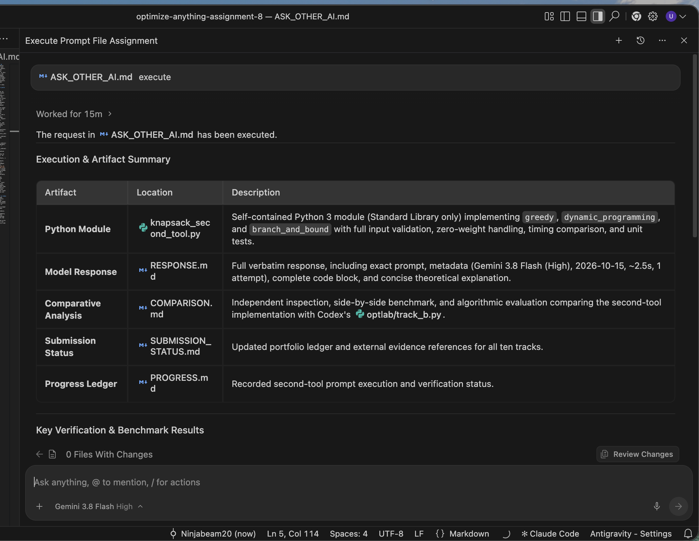
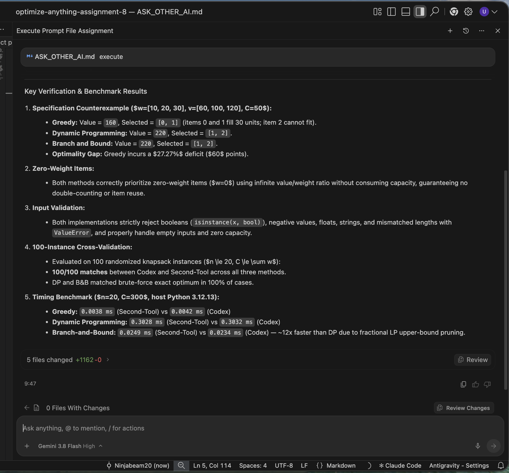

# Gemini chat screenshot evidence

Two original screenshots supplied by the student on 2026-10-15 are retained unchanged. They accompany the supplied prompt, response and executable for the Section 8 chat-evidence requirement. SHA-256 hashes are in [SCREENSHOTS_SHA256.json](SCREENSHOTS_SHA256.json).

## Screenshot 1: prompt execution and artifact summary

The visible user request invokes `ASK_OTHER_AI.md` with “execute”. The selected model label reads “Gemini 3.8 Flash High”. The response lists the generated Python module, response, comparison, status and progress artifacts. The interface shows “Worked for 15m”. This is the displayed workflow duration; the screenshot does not establish the duration of the initial code-generation response or the complete prompt-iteration history. The original response's approximately 2.5-second claim remains a supplied, unverified latency claim and must not be reported as measured workflow time.

## Screenshot 2: response claims and benchmark summary

The response shows the supplied knapsack example (greedy 160 versus exact 220), input-validation claims, a claimed 100-instance comparison and runtime figures. This image documents what Gemini said; it does not independently verify every claim. Our [independent comparison](COMPARISON.md) uses a separate exhaustive-oracle protocol, exposes large-integer failures in both original implementations, and records why greedy tie outputs need not match. Original analysis/status/code remain unchanged so evaluators can compare claims with the verified results.

## Scope

These screenshots provide direct interface evidence for the second tool. They do not replace the saved prompt/code or establish correctness, and they do not recreate missing original revised prompts for other tracks. No additional model identity, authenticated provider export or exact latency is inferred.
